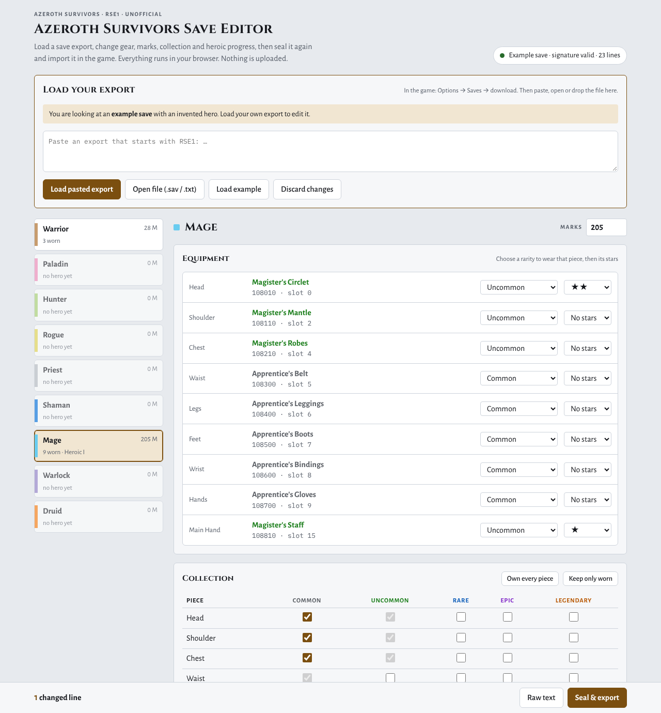

# Azeroth Survivors Save Editor

An unofficial editor for save exports of [Azeroth Survivors](https://wow.aethus.pl/).
Load an `RSE1:` export, change gear, stars, collection, marks, zone and heroic progress or any other line,
then seal it again and import it in the game.

## Download

**[AzerothSurvivors-SaveEditor.zip](https://github.com/FelixKucher/AzerothSurvivors-SaveEditor/releases/latest/download/AzerothSurvivors-SaveEditor.zip)**
(latest release, about 150 KB)

Unzip it and double-click `AzerothSurvivors-SaveEditor.html`. It is a single file with everything inside:
no installation, no server, no internet connection. Your save never leaves your computer.



## How to use it

1. In the game, open **Options → Saves** and download your save (`AzerothSurvivors <date>.sav`).
2. Open the editor and paste the export, open the file, or drop it onto the page.
   The editor checks the signature before it shows anything.
3. Pick a hero on the left and edit:
   - **Marks**
   - **Equipment**: choose a rarity to wear that piece, then its stars (0–5)
   - **Collection**: which pieces the account owns, per rarity
   - **Zones**: beaten on normal, and the heroic level (I–V) per zone
   - **Other lines** of that class (talents, spec, appearance, weapon glow…) as raw values
4. Below the heroes: account statistics, perks and all other account lines. The **Raw save text**
   panel shows the whole file and stays in sync with the fields.
5. Press **Seal & export**. The editor seals the save with a fresh nonce, decodes it again to verify it,
   and shows every changed line. Then **Copy** the export or **Save .sav file**.
6. In the game: **Options → Saves**, pick the file and confirm.

> [!WARNING]
> Keep your original export. Importing replaces the save stored in your browser, and it has not been
> tested which edits the game accepts or corrects.

## Command line

`tools/rse1.py` needs Python 3.8+ and nothing else.

```sh
python tools/rse1.py decode "AzerothSurvivors 2026-10-31 18-00-00.sav" -o save.txt
# edit save.txt
python tools/rse1.py encode save.txt -o edited.sav
python tools/rse1.py verify edited.sav
python tools/rse1.py diff "AzerothSurvivors 2026-10-31 18-00-00.sav" edited.sav
```

## The format

```
"RSE1:" + base64( nonce[16] || ciphertext || tag[20] )
K       = "azeroth-survivors/save/v1/" || 9c4e27d16af013b85de2710ca936c48f
block_i = HMAC-SHA1(K, "ks"  || nonce || uint64_le(i))   → XOR keystream
tag     = HMAC-SHA1(K, "tag" || nonce || ciphertext)
```

The plaintext is one record per line (`marks|1|1255`, `equip|1|0:101020,…`, `hbeat|1|elwynn:1,…`).
[docs/FORMAT.md](docs/FORMAT.md) covers how the format was found, the item id scheme and every record type,
each marked as verified, observed or guessed.

## Known limits

- Written against game build `d1eb6005e172`. If the developer changes the key or the format,
  loading fails with a signature error instead of producing a broken save.
- The equip slots for Hunter ranged weapons and for off-hand items (Rogue, Shaman) are derived, not seen
  in a real save. They are marked with `*` in the editor.
- Armor names are assembled from the game's set names and piece nouns and may differ from the in-game name
  for some sets.
- The example save in `examples/` belongs to an invented hero. It was sealed by this tool, not by the game.

## Development

```sh
node --test                              # JavaScript: SHA-1 and HMAC against node:crypto, vectors, save model
python -m unittest discover -s tests     # Python: vectors, tamper detection, CLI
python tools/make_fixtures.py            # regenerate the example export and tests/vectors.json
python tools/build_standalone.py         # build dist/AzerothSurvivors-SaveEditor.html and .zip
```

While working on the editor, open `index.html` directly; it loads the files in `src/`.
`tools/build_standalone.py` inlines the stylesheet, the scripts and the fonts into one HTML file and
packs it with a short README and the licenses.

The JavaScript and Python implementations are written independently. `tests/vectors.json` is produced
by the Python tool (hashlib/hmac) and must be reproduced byte for byte by `src/rse1.js`.

**Releasing:** bump `version` in `package.json`, commit, then push a matching tag (`git tag v1.1.0 && git push origin v1.1.0`).
The release workflow runs the tests, builds the ZIP and attaches it to a GitHub release for that tag.

| Path | Content |
|---|---|
| `index.html`, `src/` | the editor: `rse1.js` (format), `save.js` (line model), `catalog.js` (game data), `app.js` (UI) |
| `tools/build_standalone.py` | builds the single-file HTML and the release ZIP |
| `tools/rse1.py` | command-line decoder and encoder |
| `docs/FORMAT.md` | format reference |
| `examples/` | invented example save, plain and sealed |
| `fonts/` | self-hosted Cinzel, Alegreya Sans and IBM Plex Mono (SIL OFL 1.1) |

## Legal

This is a fan tool. It is not affiliated with or endorsed by the developer of Azeroth Survivors or by
Blizzard Entertainment. World of Warcraft names belong to Blizzard Entertainment.
Code under the [MIT License](LICENSE); fonts under the SIL Open Font License 1.1 (`fonts/OFL-*.txt`).
